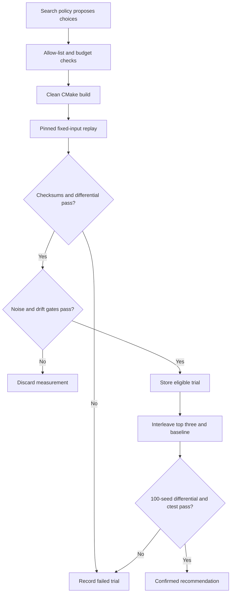

# CompilerPilot (in Ledger)

**Compiler search with a correctness oracle.** CompilerPilot lives in `tools/compilerpilot` inside [Ledger](../../README.md). It tunes how the live matching engine is compiled, measures throughput and tail latency, and rejects builds that change matching behavior. The Ledger source root is discovered automatically from this component; no submodule or separate checkout is needed.

The same Python harness runs random, genetic, surrogate-guided and LLM-guided search. The model proposes typed compiler choices. Python owns compilation, measurement, the build budget and recommendation eligibility.

## Current evidence

The [authored LLVM 18 pass](llvm/README.md) adds compiler-internals work: a C++ new-pass-manager plugin, MemorySSA-based redundant-load elimination, IR regression/equivalence tests and an explicit pass-placement experiment on `src/book.cpp`. This correctness experiment is separate from performance claims below.

The latest [conditioned runtime qualification](results/replications/runtime-20261030-01-review.md) stopped before any nominee build. After 12 fixed-time conditioning groups, the second baseline qualification group had **2.7915% within-group CV**, above the unchanged 2% limit. Both completed qualification groups passed correctness; all raw evidence is retained separately from conditioning. This was one declared attempt with no model calls, retry or confirmation.

The [first live agent search and its confirmation packet](results/studies/codespaces-agent-r5-20261030-01/review.md) used `gpt-4.1-mini-2025-04-14` against frozen Ledger source `7c43ec7`. E1 and the live semantic-mutation correctness check passed. The agent built 20 unique candidates and obtained 19 correct measurements, then a tool-use loop and provider HTTP 429 stopped the requested 40-build search. The original study remains explicitly failed/incomplete.

Two separately declared confirmations retained the same three agent-proposed nominees. R=5 stopped after 12 complete observations when maximum baseline within-group CV reached **3.1357%**; one larger-work-unit R=20 protocol stopped after 12 complete observations at **2.1409%**. Both exceed the unchanged **2%** limit, preserve their partial raw data and have no recommendation. The protocols are not pooled.

The [independent GitHub Actions replication](results/replications/gha-replication-41131249122-1-review.md) rebuilt only the original top-ranked agent nominee against the GCC baseline on a fresh four-core Ubuntu VM. All 20 interleaved R=20 observations passed correctness, but baseline variation across the ten rounds was **2.7585%**, above 2%; drift was **1.9033%**. The descriptive median difference also failed the unchanged three-sigma requirement. The result is `noisy`, with no recommendation or final-winner validation. **No confirmed compiler speedup, agent-versus-baselines advantage or predictor accuracy is claimed.**

The remaining blocker is a Linux host stable enough across the entire ten-round confirmation. [Cornell Red Cloud exploratory access](docs/cornell-exploratory-access.md) offers 165 free compute units to eligible first-time Cornell users, with dedicated CPU cores and RAM; access has not been requested or provisioned, and a future host must still qualify. No further automatic attempt is scheduled. Additional model calls would not resolve this measurement failure.

The recorded API allocation conservatively accounts for **$3.1319276** across 89 requests, including a retained $0.425584 reservation for the uncertain failed request. This is controller accounting, not an invoice or a claim about the provider's final charge. The same allocation and checkpoint remain authoritative; it has not been reset.

See [measured results](results/summary.md), [methodology](docs/methodology.md), and [qualification status](results/status.md).

Historical qualification files retain their original provenance. The pre-integration attempt at Ledger commit `c0dbffd6a036feb27e225362a92df9792d8e844a` measured **13.61% baseline variation**, above the 2% limit, so its performance sweep and strategy comparison did not run.

A separate [hosted-runner qualification](results/studies/gha-41074339510-1/summary.md) used five million commands on AMD EPYC 9V45 and also failed the noise gate (**8.03% CV**). It made no model calls and did not proceed to search. Its different hardware and replay length do not establish a speedup over the earlier results.

The [free Codespaces qualification](results/studies/codespaces-20261030-01/review.md) completed ten observations of five reported runs on a four-core, 16 GB Ubuntu host. Its conservative CV was **2.5335%**, so it also failed the unchanged 2% gate. All correctness checks passed; no model call or compiler search ran. The original raw measurements and launch log remain unchanged.

A later [predeclared R=5 qualification](results/studies/codespaces-r5-20261030-01/review.md) passed at **1.5285% CV**. That is baseline qualification on its recorded source/boot, not a confirmed optimization result; the later live-agent attempt and its independent confirmation outcomes are reported separately above.

## Run it

Linux x86-64, Python 3.11+, GCC 13+, Clang/LLVM 17+, CMake 3.21+, Ninja, binutils and `taskset` are required. Install matching LLVM profiling and `lld` packages for Clang PGO/ThinLTO. Hardware `perf` events need host support and permissions; unavailable counters are recorded explicitly.

The archived profiling evidence includes long encoded paths. When cloning the repository on Windows, use `git clone -c core.longpaths=true https://github.com/michaelbawuah/Ledger.git`. In an existing checkout, run `git config core.longpaths true` before pulling that evidence. The recorded filenames and hashes remain unchanged.

```bash
git clone https://github.com/michaelbawuah/Ledger.git
cd Ledger/tools/compilerpilot
python3 -m venv .venv
. .venv/bin/activate
python -m pip install -e '.[dev]'
python -m pytest
python -m compilerpilot data
python -m compilerpilot baseline --cpu 0 --run-id E1
python scripts/check_gate.py --input data/eval.lob
```

Run all commands in this document from `Ledger/tools/compilerpilot`, with the virtual environment active. CompilerPilot discovers the enclosing Ledger root; `--ledger /path/to/Ledger` selects an explicit source checkout when needed. New trials record the live Ledger commit, relevant source/configuration fingerprint and dirty state, rather than retaining the historical qualification commit. The input manifest binds the source and workload protocol; use a new data/results location when either changes.

New mutation checks default to `results/live-gate-check.json`; the original qualification JSON remains historical evidence.

Choose a CPU allowed by `taskset -pc $$`. Keep the machine quiet during measurement. Each baseline command makes ten observations, each with five benchmark runs and a warmup. A failed noise gate stops subsequent search.

```bash
python -m compilerpilot sweep --cpu 0 --run-id E2
python -m compilerpilot experiment --strategy random --budget 40 --seed 0 --cpu 0
python -m compilerpilot experiment --strategy genetic --budget 40 --seed 0 --cpu 0
python -m compilerpilot experiment --strategy surrogate --budget 40 --seed 0 --cpu 0
# Set OPENAI_API_KEY or ANTHROPIC_API_KEY securely in your environment first.
python -m compilerpilot experiment --strategy agent --provider openai --model gpt-4.1-mini-2025-04-14 --budget 40 --seed 0 --cpu 0 --api-budget-file data/api-allocation.json --api-budget-usd 9.99
python -m compilerpilot report
```

Use an exact model version that supports tool use, temperature zero and, for OpenAI, the seed parameter. The tool loop records model, sampling settings, request/response traces, hypotheses and tool results. Anthropic does not expose a matching seed parameter; that limitation is recorded. A provider error is an incomplete experiment, never a fallback search result.

`python scripts/run_study.py --phase study --study-id research-01 --model gpt-4.1-mini-2025-04-14 --provider openai --cpu 0 --api-budget-file data/api-allocation.json --api-budget-usd 9.99` runs E1, E2 and the full E3 matrix sequentially: four strategies, three seeds and forty unique builds per strategy/seed. Preflight credentials first. Run IDs cannot overwrite existing evidence. A noisy or drifting batch stops the study and must be rerun under a new ID. Reports inventory all attempts.

## Controlled study runner

Set `COMPILERPILOT_PROGRESS=1` to stream selected recorded event names and counts to stderr during a long study. Progress omits payloads, model text and credentials, and emits nothing when no new event is recorded. It is disabled by default; per-run protocol metadata records its setting.

The manual [controlled-study workflow](../../.github/workflows/compilerpilot-study.yml) starts with a fresh Linux VM and preserves every attempt. Select **baseline** first: this makes no model calls, uses CPU 0, ten observations with five raw runs each, the existing correctness checks, and a fixed replay length. The default replay contains five million commands to make individual measurements longer. No outliers are removed and failed qualification is not retried automatically.

A standard hosted VM is a candidate measurement host; it is not assumed to have an exclusive physical CPU. Only a recorded CV below 2% qualifies it. A later **study** dispatch runs its own baseline again on that job's VM, followed by all strategies serially; calibration from a different VM is never treated as its baseline. A full study is 480 candidate builds and may exceed a hosted job's time limit, in which case the attempt remains incomplete. Use a quiet Linux host for sustained runs when needed.

For a real model run, add `OPENAI_API_KEY` or `ANTHROPIC_API_KEY` privately in the repository's GitHub Actions secrets and supply an exact supported model version. Keep credentials out of chat, source and artifacts. Provider charges apply to real model calls; the build budget and model-call limits are recorded with the run. No model call is made during baseline qualification.

After a Codespace qualifies, the [encrypted credential delivery workflow](docs/codespaces-access.md) can transfer its existing Actions key directly to that Codespace without displaying the plaintext key.

Local qualification uses the same runner:

```bash
python scripts/run_study.py --phase baseline --study-id local-qualification --commands 5000000 --cpu 0
```

Artifacts include the protocol, source identity, raw replay observations and failure details. A failed noise gate stops the attempt; a new host or explicitly changed protocol requires a new study ID.

### Focused speedup confirmation

`--scope agent-speedup` asks whether one real agent run can find a confirmed compiler improvement on the declared workload. It runs E1, the live semantic-mutation correctness check, **one seed-0 agent search with 40 unique candidate builds**, and E5. It skips the knob sweep, other policies/seeds and E4 predictor evaluation. The default `--scope full` retains the original four-policy × three-seed × 40-build comparison. A focused result does not establish that the agent beats random, genetic or surrogate search.

Qualify the focused protocol without a credential first:

```bash
python scripts/run_study.py --phase baseline --scope agent-speedup \
  --study-id agent-speedup-01 --commands 5000000 --throughput-replays 5 --cpu 0 --jobs 2
```

After that attempt passes, securely supply the existing provider key and resume on the **same source, host boot, input and protocol**, using the existing shared allocation:

```bash
python scripts/run_study.py --phase study --scope agent-speedup --resume \
  --study-id agent-speedup-01 --commands 5000000 --throughput-replays 5 --cpu 0 --jobs 2 \
  --provider openai --model gpt-4.1-mini-2025-04-14 \
  --api-budget-file data/api-allocation.json --api-budget-usd 9.99
```

The actual strategy plan is recorded explicitly as agent, seed 0, budget 40, regardless of unused multi-seed defaults. The scope is immutable across qualification and resumption. A completed focused run cannot be reopened as a full comparison. `speedup_confirmed` requires E5's ten interleaved rounds, an improvement above three times baseline noise, the unchanged 2% variability/drift limits, full 100-seed × one-million-command differential validation, all planned CTests and the final source/host/input checks. A lack of improvement, disabled confirmation, interrupted phase or failed gate remains explicit; no winner is invented.

For a zero-inference alternative, `--scope speedup` runs E1, the same live correctness check, the complete 14-candidate one-at-a-time knob sweep and E5. For example:

```bash
python scripts/run_study.py --phase study --scope speedup --study-id sweep-speedup-01 \
  --commands 5000000 --throughput-replays 5 --cpu 0 --jobs 2
```

This scope needs no model credential or API allocation and makes no model calls. Any confirmed result is attributed to the knob sweep. All focused scopes retain raw measurements and the same correctness, noise, drift, candidate-selection and confirmation gates; they change the requested search coverage only.

## Fixed throughput windows

`--throughput-replays R` is an optional measurement setting, bounded to 1–20 and defaulting to **1**. Each reported throughput run replays the fixed input R times into R fresh empty books and divides all processed commands by the sum of **every** replay duration. Every block must match the single-input reference state and checksums. Individual durations and checksums remain in `throughput_replays.csv`; no block is removed or selected by its speed. The separate latency pass and exact latency histogram still contain one input replay.

The completed [R=5 Codespaces qualification](results/studies/codespaces-r5-20261030-01/review.md) used **R=5 with the existing five-million-command input**: 25 million commands of measured throughput work per reported run, with a separate five-million-command latency pass. This extended the measured work without increasing the input or latency-array working set. It was a new predeclared protocol, with its own evidence. An illustrative baseline command using fresh source-bound folders is:

```bash
python scripts/run_study.py --phase baseline --study-id codespaces-window-r5 \
  --commands 5000000 --throughput-replays 5 --cpu 0 \
  --data data/codespaces-window-r5 --results results/studies/codespaces-window-r5
```

This example does not schedule another attempt. The same R must be used for E1, the knob sweep, all four search policies, drift checkpoints and interleaved confirmation. A new source or replay setting cannot resume an older study. The 2% noise limit and three-spread significance requirement remain unchanged. Longer work can reduce the relative effect of a short interruption; recurring contention and clock-frequency changes can still fail the gate. No automatic retry seeks a passing result. Reports do not pool different replay settings into rankings, search comparisons or predictor validation; historical records without R mean R=1.

## Check provider compatibility first

The manual [provider compatibility workflow](../../.github/workflows/compilerpilot-provider-check.yml) makes exactly one harmless OpenAI request, with no retries, builds or benchmarks. It checks the study's existing Chat Completions request shape: strict function tools, `temperature=0`, `seed=0`, and a reduced 512-token completion limit. Its artifact contains only model IDs, request ID, numeric usage, a fixed status and the harmless tool name. A compatibility pass is not an agent performance result.

The default snapshot is `gpt-4.1-mini-2025-04-14`. It remains API-available but is deprecated, with shutdown scheduled for **January 14, 2027**; see the official [model page](https://developers.openai.com/api/docs/models/gpt-4.1-mini) and [deprecation notice](https://developers.openai.com/api/docs/deprecations). The seed parameter is deprecated and offers best-effort repeatability, not deterministic execution. This check requires the returned model ID to match the requested snapshot exactly. It does not establish that the account has enough quota for a full study.

With `OPENAI_API_KEY` supplied securely in the environment, the same bounded check runs locally:

```bash
python scripts/check_provider.py --model gpt-4.1-mini-2025-04-14 --output results/provider-check.json
```

## Enforced shared API allocation

The current approval allows **$10 total for model calls**. A conservative **$0.01 reserve** covers the already completed provider check, leaving **$9.99 for the full study**. No further live preflight is needed under this allocation. This controller covers API calls independently of the measurement host. Using an included Codespaces compute allowance does not make model API usage free.

Every live agent command requires the existing shared budget file. The approved pricing configuration permits only `gpt-4.1-mini-2025-04-14` with `service_tier=default`, at $0.40 per million input tokens and $1.60 per million output tokens. Before each request, the controller atomically reserves the maximum model input context (1,047,576 tokens) plus the requested completion cap (4,096 tokens), **$0.425584 per study request**. Exact integer nanodollars avoid floating-point rounding. Actual verified usage refunds the difference; all prompt tokens are conservatively charged at the uncached rate. The controller stops before a request if its full reservation would exceed the remaining allocation.

Initialize the allocation **once**, then pass the same file to all three agent seeds and every subsequent attempt under this approval:

```bash
python -m compilerpilot.api_budget init --file data/api-allocation.json --limit-usd 9.99
python -m compilerpilot.api_budget status --file data/api-allocation.json --limit-usd 9.99
python scripts/run_study.py --phase study --study-id research-01 \
  --provider openai --model gpt-4.1-mini-2025-04-14 --cpu 0 \
  --api-budget-file data/api-allocation.json --api-budget-usd 9.99
```

The study never initializes or resets an allocation automatically. Preserve the original JSON **and its `.lock` checkpoint** across seeds, study IDs, interrupted attempts and host moves; keep them outside the per-study results directory. The checkpoint binds the latest revision and file hash, so missing state, a changed limit, a corrupt file or an older JSON snapshot fails closed. Do not create a second allocation or restore an older matching file pair to regain funds. The launcher must retain this one authoritative allocation; filesystem operators can replace files, so an audit copy is not independent spending authority.

There are no automatic retries or redirects. Missing or malformed usage, unexpected model/tier, timeouts and ambiguous provider errors retain the entire reservation and stop the experiment. A crash between durable writes can also block further requests; preserve the state instead of resetting it. Budget exhaustion leaves the run incomplete with all existing measurements retained. Each study exports `api-budget-snapshot.json` for audit alongside its partial or completed results.

## How a trial works



Every successful benchmark checks the reference, fast-bitmap and fast-linear event/trade checksums and final state, verifies raw CSV medians against JSON, and runs an independent five-seed × 100,000-command differential test. The binary's recorded flags, input SHA-256, binary SHA-256, CPU affinity and live Ledger source identity must match the trial.

Each candidate uses a clean directory and bounded subprocess execution without a shell. Compile failures consume budget. Duplicate candidates do not. Successful builds must be measured before a run can finish. Builds that fail correctness can never be recommended. Source changes and evaluation-input changes invalidate comparison.

## Search space

| Choice | Allowed values |
|---|---|
| Compiler | GCC, Clang |
| Optimization | O2, O3 |
| ISA | portable default, x86-64-v3, native |
| LTO | off, full GCC LTO / Clang ThinLTO with lld |
| PGO | off, separate-seed instrument/train/use pipeline |
| Inline threshold | default, 100, 500 |
| Loop unrolling | default, enabled |
| Vectorization | default, disabled |
| Frame pointer | default, preserved |
| Function alignment | default, 32, 64 bytes |
| Semantic interposition | default, disabled |

Unsafe math, free-form flags, arbitrary executables and source rewrites are excluded. `space.py` maps typed values to fixed flags. GCC and Clang PGO use distinct compiler-specific pipelines, with training seed 20261012 and evaluation seed 20261011 by default. Training profiles must exist, and the measured hot-path profiles must be consumed. The separate [authored LLVM pass experiment](llvm/README.md) implements a MemorySSA-based redundant-load elimination pass and compares placement before and after LLVM's standard pipeline on the live matching engine. It does not add arbitrary pass strings to the agent's search space. Unrestricted pass-order search and MLIR remain future work.

Random search samples the allow-list. Genetic search uses population eight, tournament selection, one-point crossover and 0.2 mutation rate. Surrogate search starts with eight measured trials, then ranks an unseen candidate pool with a random forest. Training uses one-hot compiler choices and log measured speedup, excluding failed or invalid measurements. Predictor validation deduplicates repeated candidates before out-of-fold evaluation; it reports MAE in speedup percentage points and Spearman correlation.

## Evidence and confirmation

`results/trials.parquet` indexes every candidate, including failures. Each run retains an append-only `trace.jsonl` and `trials.jsonl`; atomic snapshots reflect later drift invalidations. All strategies share the same harness. Reports keep independent runs separate and label incomplete protocol coverage. They never merge favorable observations across repeated attempts.

To confirm three measured builds:

```bash
python -m compilerpilot confirm \
  --baseline results/runs/RUN_ID/baseline.json \
  --candidates builds/RUN_ID/CANDIDATE_A/build.json builds/RUN_ID/CANDIDATE_B/build.json builds/RUN_ID/CANDIDATE_C/build.json \
  --input data/eval.lob --rounds 10 --cpu 0
```

Confirmation uses A, B, C, baseline in each round. A speedup must exceed three baseline standard deviations. Baseline CV and drift must remain below 2%; candidate noise is also checked. Final recommendation requires a 100-seed × 1,000,000-command differential test and the complete Ledger CTest suite. `finish` is explicitly provisional until confirmation.

## Limitations

One synthetic workload on one CPU cannot establish general compiler performance. PGO may overfit its training distribution even with separate seeds. Shared hosts can fail the noise gate; CPU pinning does not eliminate contention or frequency changes. Hardware counters can be unavailable in virtual machines. Models and provider behavior vary across versions, and temperature zero does not guarantee identical decisions. A negative or incomplete comparison remains visible in the report.

The canonical component is [Ledger/tools/compilerpilot](https://github.com/michaelbawuah/Ledger/tree/main/tools/compilerpilot). See the [Ledger overview](../../README.md). This component does not publish resume speedup or predictor-accuracy numbers before the corresponding experiments produce them.
