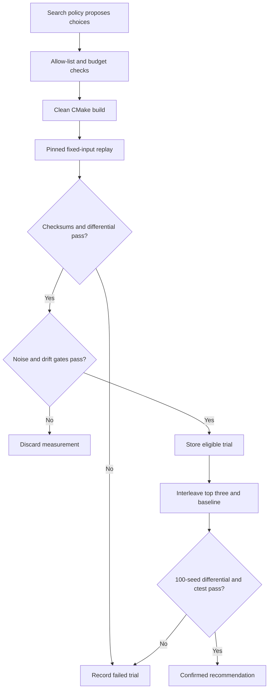

# CompilerPilot (in Ledger)

**Compiler search with a correctness oracle.** CompilerPilot lives in `tools/compilerpilot` inside [Ledger](../../README.md). It tunes how the live matching engine is compiled, measures throughput and tail latency, and rejects builds that change matching behavior. The Ledger source root is discovered automatically from this component; no submodule or separate checkout is needed.

The same Python harness runs random, genetic, surrogate-guided and LLM-guided search. The model proposes typed compiler choices. Python owns compilation, measurement, the build budget and recommendation eligibility.

## Current evidence

The implementation includes four search policies, compiler/PGO pipelines, feedback parsers and correctness gates. The committed qualification artifacts under `results/` were collected against Ledger commit `c0dbffd6a036feb27e225362a92df9792d8e844a`, before this component moved into Ledger. Those historical files retain their original provenance. The ten-observation E1 measurement completed with **13.61% baseline variation**, above the **2% noise limit**; E2–E5 performance experiments did not run. **No new speedup, strategy advantage or predictor accuracy is claimed.**

The LLM provider adapters and protocol tests are implemented, but a live API experiment has not run. Such an experiment requires a provider credential and a pinned model; missing credentials cause an explicit error.

See [measured results](results/summary.md), [methodology](docs/methodology.md), and [qualification status](results/status.md).

A separate [hosted-runner qualification](results/studies/gha-41074339510-1/summary.md) used five million commands on AMD EPYC 9V45 and also failed the noise gate (**8.03% CV**). It made no model calls and did not proceed to search. Its different hardware and replay length do not establish a speedup over the earlier results.

## Run it

Linux x86-64, Python 3.11+, GCC 13+, Clang/LLVM 17+, CMake 3.21+, Ninja, binutils and `taskset` are required. Install matching LLVM profiling and `lld` packages for Clang PGO/ThinLTO. Hardware `perf` events need host support and permissions; unavailable counters are recorded explicitly.

```bash
git clone https://github.com/michaelbawuah/Ledger.git
cd Ledger/tools/compilerpilot
python3 -m venv .venv
. .venv/bin/activate
python -m pip install -e '.[dev]'
python -m pytest
python -m compilerpilot data
python -m compilerpilot baseline --cpu 0 --run-id E1
python scripts/check_gate.py --input data/eval.lob
```

Run all commands in this document from `Ledger/tools/compilerpilot`, with the virtual environment active. CompilerPilot discovers the enclosing Ledger root; `--ledger /path/to/Ledger` selects an explicit source checkout when needed. New trials record the live Ledger commit, relevant source/configuration fingerprint and dirty state, rather than retaining the historical qualification commit. The input manifest binds the source and workload protocol; use a new data/results location when either changes.

New mutation checks default to `results/live-gate-check.json`; the original qualification JSON remains historical evidence.

Choose a CPU allowed by `taskset -pc $$`. Keep the machine quiet during measurement. Each baseline command makes ten observations, each with five benchmark runs and a warmup. A failed noise gate stops subsequent search.

```bash
python -m compilerpilot sweep --cpu 0 --run-id E2
python -m compilerpilot experiment --strategy random --budget 40 --seed 0 --cpu 0
python -m compilerpilot experiment --strategy genetic --budget 40 --seed 0 --cpu 0
python -m compilerpilot experiment --strategy surrogate --budget 40 --seed 0 --cpu 0
# Set OPENAI_API_KEY or ANTHROPIC_API_KEY securely in your environment first.
python -m compilerpilot experiment --strategy agent --provider openai --model MODEL_ID --budget 40 --seed 0 --cpu 0
python -m compilerpilot report
```

Use an exact model version that supports tool use, temperature zero and, for OpenAI, the seed parameter. The tool loop records model, sampling settings, request/response traces, hypotheses and tool results. Anthropic does not expose a matching seed parameter; that limitation is recorded. A provider error is an incomplete experiment, never a fallback search result.

`python scripts/run_study.py --phase study --study-id research-01 --model MODEL_ID --provider openai --cpu 0` runs E1, E2 and the full E3 matrix sequentially: four strategies, three seeds and forty unique builds per strategy/seed. Preflight credentials first. Run IDs cannot overwrite existing evidence. A noisy or drifting batch stops the study and must be rerun under a new ID. Reports inventory all attempts.

## Controlled study runner

The manual [controlled-study workflow](../../.github/workflows/compilerpilot-study.yml) starts with a fresh Linux VM and preserves every attempt. Select **baseline** first: this makes no model calls, uses CPU 0, ten observations with five raw runs each, the existing correctness checks, and a fixed replay length. The default replay contains five million commands to make individual measurements longer. No outliers are removed and failed qualification is not retried automatically.

A standard hosted VM is a candidate measurement host; it is not assumed to have an exclusive physical CPU. Only a recorded CV below 2% qualifies it. A later **study** dispatch runs its own baseline again on that job's VM, followed by all strategies serially; calibration from a different VM is never treated as its baseline. A full study is 480 candidate builds and may exceed a hosted job's time limit, in which case the attempt remains incomplete. Use a quiet Linux host for sustained runs when needed.

For a real model run, add `OPENAI_API_KEY` or `ANTHROPIC_API_KEY` privately in the repository's GitHub Actions secrets and supply an exact supported model version. Keep credentials out of chat, source and artifacts. Provider charges apply to real model calls; the build budget and model-call limits are recorded with the run. No model call is made during baseline qualification.

Local qualification uses the same runner:

```bash
python scripts/run_study.py --phase baseline --study-id local-qualification --commands 5000000 --cpu 0
```

Artifacts include the protocol, source identity, raw replay observations and failure details. A failed noise gate stops the attempt; a new host or explicitly changed protocol requires a new study ID.

## Check provider compatibility first

The manual [provider compatibility workflow](../../.github/workflows/compilerpilot-provider-check.yml) makes exactly one harmless OpenAI request, with no retries, builds or benchmarks. It checks the study's existing Chat Completions request shape: strict function tools, `temperature=0`, `seed=0`, and a reduced 512-token completion limit. Its artifact contains only model IDs, request ID, numeric usage, a fixed status and the harmless tool name. A compatibility pass is not an agent performance result.

The default snapshot is `gpt-4.1-mini-2025-04-14`. It remains API-available but is deprecated, with shutdown scheduled for **January 14, 2027**; see the official [model page](https://developers.openai.com/api/docs/models/gpt-4.1-mini) and [deprecation notice](https://developers.openai.com/api/docs/deprecations). The seed parameter is deprecated and offers best-effort repeatability, not deterministic execution. This check requires the returned model ID to match the requested snapshot exactly. It does not establish that the account has enough quota for a full study.

With `OPENAI_API_KEY` supplied securely in the environment, the same bounded check runs locally:

```bash
python scripts/check_provider.py --model gpt-4.1-mini-2025-04-14 --output results/provider-check.json
```

## How a trial works



Every successful benchmark checks the reference, fast-bitmap and fast-linear event/trade checksums and final state, verifies raw CSV medians against JSON, and runs an independent five-seed × 100,000-command differential test. The binary's recorded flags, input SHA-256, binary SHA-256, CPU affinity and live Ledger source identity must match the trial.

Each candidate uses a clean directory and bounded subprocess execution without a shell. Compile failures consume budget. Duplicate candidates do not. Successful builds must be measured before a run can finish. Builds that fail correctness can never be recommended. Source changes and evaluation-input changes invalidate comparison.

## Search space

| Choice | Allowed values |
|---|---|
| Compiler | GCC, Clang |
| Optimization | O2, O3 |
| ISA | portable default, x86-64-v3, native |
| LTO | off, full GCC LTO / Clang ThinLTO with lld |
| PGO | off, separate-seed instrument/train/use pipeline |
| Inline threshold | default, 100, 500 |
| Loop unrolling | default, enabled |
| Vectorization | default, disabled |
| Frame pointer | default, preserved |
| Function alignment | default, 32, 64 bytes |
| Semantic interposition | default, disabled |

Unsafe math, free-form flags, arbitrary executables and source rewrites are excluded. `space.py` maps typed values to fixed flags. GCC and Clang PGO use distinct compiler-specific pipelines, with training seed 20261012 and evaluation seed 20261011 by default. Training profiles must exist, and the measured hot-path profiles must be consumed. LLVM pass reordering is an unimplemented stretch goal.

Random search samples the allow-list. Genetic search uses population eight, tournament selection, one-point crossover and 0.2 mutation rate. Surrogate search starts with eight measured trials, then ranks an unseen candidate pool with a random forest. Training uses one-hot compiler choices and log measured speedup, excluding failed or invalid measurements. Predictor validation deduplicates repeated candidates before out-of-fold evaluation; it reports MAE in speedup percentage points and Spearman correlation.

## Evidence and confirmation

`results/trials.parquet` indexes every candidate, including failures. Each run retains an append-only `trace.jsonl` and `trials.jsonl`; atomic snapshots reflect later drift invalidations. All strategies share the same harness. Reports keep independent runs separate and label incomplete protocol coverage. They never merge favorable observations across repeated attempts.

To confirm three measured builds:

```bash
python -m compilerpilot confirm \
  --baseline results/runs/RUN_ID/baseline.json \
  --candidates builds/RUN_ID/CANDIDATE_A/build.json builds/RUN_ID/CANDIDATE_B/build.json builds/RUN_ID/CANDIDATE_C/build.json \
  --input data/eval.lob --rounds 10 --cpu 0
```

Confirmation uses A, B, C, baseline in each round. A speedup must exceed three baseline standard deviations. Baseline CV and drift must remain below 2%; candidate noise is also checked. Final recommendation requires a 100-seed × 1,000,000-command differential test and the complete Ledger CTest suite. `finish` is explicitly provisional until confirmation.

## Limitations

One synthetic workload on one CPU cannot establish general compiler performance. PGO may overfit its training distribution even with separate seeds. Shared hosts can fail the noise gate; CPU pinning does not eliminate contention or frequency changes. Hardware counters can be unavailable in virtual machines. Models and provider behavior vary across versions, and temperature zero does not guarantee identical decisions. A negative or incomplete comparison remains visible in the report.

The canonical component is [Ledger/tools/compilerpilot](https://github.com/michaelbawuah/Ledger/tree/main/tools/compilerpilot). See the [Ledger overview](../../README.md). This component does not publish resume speedup or predictor-accuracy numbers before the corresponding experiments produce them.
