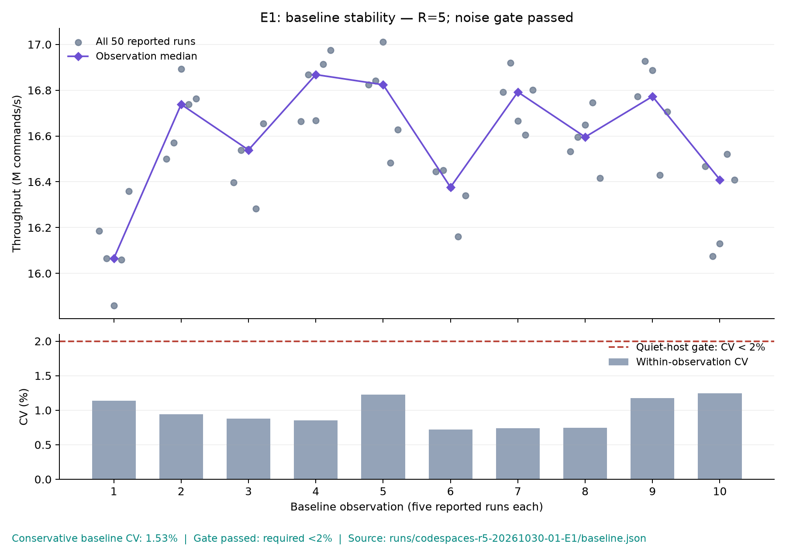

# CompilerPilot measured results

Throughput protocol: **R=5 fresh-book replay(s) per reported run**. Throughput divides all replayed commands by the sum of every replay duration; latency remains a separate single-input pass. Historical records without an explicit replay count mean R=1.

Recorded 0 trials; the E3 inventory contains 0 experiments. 0 correctness-passing, measurement-valid trials belong to the selected single runs. 0 correctness/build failures; 0 correctness-passing trials excluded by the measurement gate.

E3 comparison: **incomplete**. Target: four strategies × 3 seeds × 40 candidate builds.

| Strategy | Observed builds per seed | Coverage |
|---|---|---|
| random | no trials | 0/3 seeds; incomplete |
| genetic | no trials | 0/3 seeds; incomplete |
| surrogate | no trials | 0/3 seeds; incomplete |
| agent | no trials | 0/3 seeds; incomplete |

## Experiment status

| Experiment | Recorded status |
|---|---|
| E1: machine noise | passing noise gate recorded; 10 baseline observations |
| E2: one-knob sweep | not performed |
| E3: fixed-budget search comparison | not performed |
| E4: held-out predictor quality | not performed; insufficient valid search trials |
| E5: performance-winner confirmation | not performed; no performance winner |

## Experiment inventory

Experiments are never combined within a strategy/seed. The fixed selection rule uses the earliest complete predeclared protocol run; if none qualifies, it shows the longest single partial run, breaking ties by start time and run ID. Throughput does not affect this selection. Every attempt remains listed below, including replaced or failed runs.

| Run | Strategy | Seed | R | Builds | Valid | Failed | Noise-excluded | Selected | Protocol status |
|---|---|---:|---:|---:|---:|---:|---:|---|---|

No search experiments are recorded.

## E1: baseline noise

Baseline files are reported separately by experiment. The qualification measurement is a smoke check; E1 requires ten baseline observations. Noise gate: conservative coefficient of variation below 2%; candidate significance threshold: three baseline standard deviations.

| Baseline run | Observations | R | Throughput (M cmd/s) | p99 (ns) | Spread (M cmd/s) | CV | Compile (s) | .text (KiB) | Correct | Noise gate / E1 |
|---|---:|---:|---:|---:|---:|---:|---:|---:|---|---|
| [codespaces-r5-20261030-01-E1](runs/codespaces-r5-20261030-01-E1/baseline.json) | 10 | 5 | 16.667 | 300.5 | 0.255 | 1.53% | 22.26 | 103.31 | pass | pass; E1 measurement complete |

Every reported run is plotted. At R>1 each point aggregates all R fresh-book throughput replays; individual block evidence remains in throughput_replays.csv. Diamond markers show each observation median; the lower panel shows its CV. The gate uses the larger within-observation or across-observation noise estimate. Figure sources, replay counts and hashes are recorded in [e1-plot-data.json](e1-plot-data.json).

## Functional build qualification

These raw measurements establish that each compiler/PGO path builds, replays, and passes the per-build differential oracle. They ran on a noisy shared host and are not a controlled performance comparison. No speedup ratio is calculated.

| Qualification build | Reported runs | R | Median (M cmd/s) | p99 (ns) | CV | Compile (s) | .text (KiB) | Correctness |
|---|---:|---:|---:|---:|---:|---:|---:|---|

No functional qualification measurements are recorded.

## Recorded search builds

Each strategy row is its best observed candidate, ranked by median raw speedup; repeated measurements of that candidate are summarized with medians. Values include only trials passing both gates. A raw ratio is not a confirmed improvement.

| Build | Throughput (M cmd/s) | p99 (ns) | Compile (s) | .text (KiB) | Raw speedup | Baseline spread | Correctness | Noise significance |
|---|---:|---:|---:|---:|---:|---:|---|---|

No trials currently pass both correctness and measurement gates. No performance winner is reported.

## Predictor validation

Not enough distinct valid candidates for held-out validation (0 available).

## Interpretation and limits

Only recorded measurements appear here. Search results do not establish a final winner until interleaved confirmation, the full 100-seed differential test, and ctest pass. These observations describe one benchmark on its recorded machine; CPU-specific flags and synthetic PGO training may not transfer. Model and provider versions can change agent behavior. Unavailable hardware counters must be reported as unavailable rather than zero.
